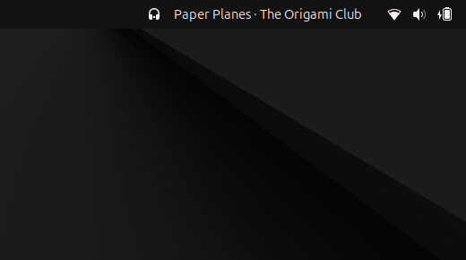
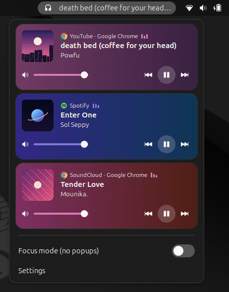
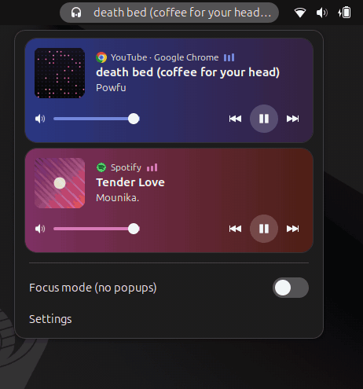
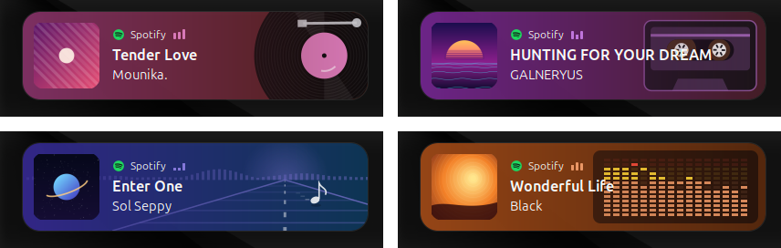
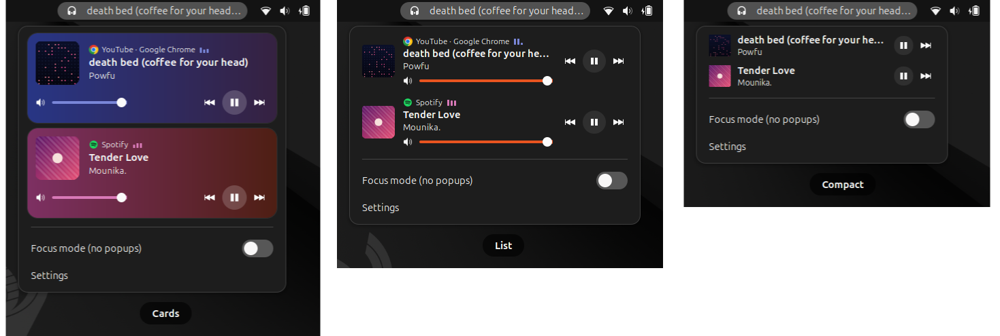
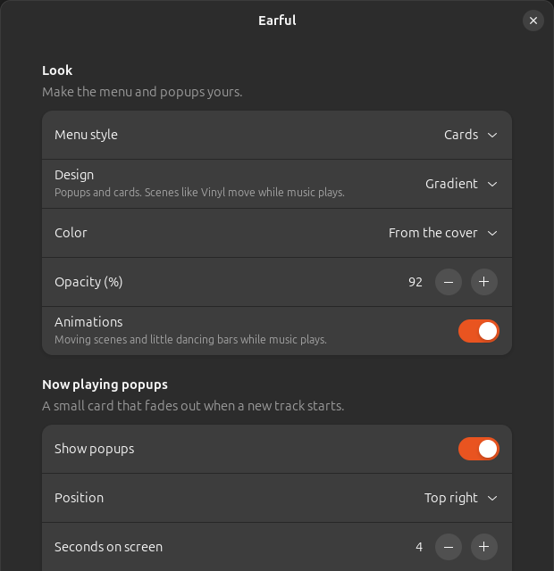

<div align="center">

# Earful

**Every player, one click away.**

One button in the GNOME top bar for everything that plays: Spotify, YouTube tabs, Twitch, podcasts.
Pause, skip or change the volume without switching windows, and see each new song in a small popup
at a glance, while you keep working.




</div>

---

## Install

Open a terminal and run:

```bash
curl -fsSL https://raw.githubusercontent.com/NGdev2/earful/main/install.sh | sh
```

Then restart your computer. From then on Earful starts by itself (switch it off any time in the Extensions app).

It needs GNOME 46 or newer and no sudo: everything goes into your home folder. You can [read the script](install.sh) first.

### Browser tabs as separate players (optional)

Without this, Earful shows your browser as one player. With it, **every tab that plays gets its own row**. Add the free *Earful Bridge* add-on to your browser; Earful sets up everything else by itself.

- **Chrome, Brave, Edge, Vivaldi, Opera:** [add Earful Bridge from the Chrome Web Store](https://chromewebstore.google.com/detail/hlomkcgmmialafamfkkpiamgefhlidll).
- **Firefox:** [add Earful Bridge from Firefox Add-ons](https://addons.mozilla.org/firefox/addon/earful-bridge/).

Firefox from Snap asks once whether it may start Earful: choose *Allow*. Browsers installed as Flatpak, and Chromium from Snap, can't use the add-on yet.

<details>
<summary><b>Install from source</b> (for developers; not needed if you ran the command above)</summary>
<br>

```bash
git clone https://github.com/NGdev2/earful.git
cd earful
make install
```

`make install` does exactly what the command above does, from your checkout.
</details>

To remove Earful: `curl -fsSL https://raw.githubusercontent.com/NGdev2/earful/main/install.sh | sh -s -- --uninstall`

## Why Earful?

**"Who sings this?"** When the track changes, a small card fades in with the cover, title and artist, then quietly fades out. Several changes at once stack neatly and slide into place.

**One click, every player.** All your players in one list, each with its own play / pause / next. Click a track to jump straight to its app.

**Every browser tab is its own player.** Three YouTube tabs, three rows. Click one and Earful switches to that exact tab (Chrome, Brave, Edge and other Chromium browsers, Firefox).

**A mini mixer.** A volume slider on every player and every tab, plus (optional) apps that only make sound, like games and calls.

<p align="center">
  
</p>

**Your look.** A spinning vinyl, a cassette, a retro hi-fi equalizer, a sound wave or a note riding the road, in the colors of each album cover or one you pick. Or keep it calm: a gradient, dark glass, or your system theme.

<p align="center">
  
</p>
<p align="center">
  
</p>

**Your rules.** Pause other players when one starts (with exceptions), and send media keys to the last active or a pinned player.

**Focus mode.** Deep in code? One shortcut (<kbd>Super</kbd> + <kbd>Shift</kbd> + <kbd>M</kbd>) silences every popup. No popups over fullscreen games or while Do Not Disturb is on.

**You decide.** Cards, list or compact menu; popup position, duration, how many at once, and which players are allowed to show them.

<details>
<summary>More screenshots</summary>
<br>
<p align="center">
  
</p>
<p align="center">
  
</p>
</details>

## Coming next

- One-click install from extensions.gnome.org (GNOME's official extension website): in review
- An ignore list for autoplay noise

## How it works

Linux media players announce what they play through [MPRIS](https://specifications.freedesktop.org/mpris-spec/latest/), a shared standard. Earful listens to it, so Spotify, VLC, Rhythmbox, browsers and more show up by themselves. For mpv, install the `mpv-mpris` plugin (`sudo apt install mpv-mpris`); without it, mpv still shows under *Other audio* with the file it plays.

Browsers announce only one player for all their tabs. The Earful Bridge add-on reports each playing tab to a small helper program that comes with Earful, and the helper announces every tab as its own player. Details: [browser-extension](browser-extension/README.md) · [the helper](docs/bridge.md).

No tracking, nothing sent anywhere: the only network traffic is loading cover art from the address a player provides. See [PRIVACY.md](PRIVACY.md).

## Contributing

Ideas, bugs and pull requests are welcome: open an [issue](https://github.com/NGdev2/earful/issues).

- Try it without real music: `gjs -m tools/fake-player.js MyPlayer 5`
- `make test` runs Earful in an invisible, isolated GNOME Shell; `make test-gnome-versions` does it for GNOME 47–51 in containers
- `make bridge-test`, `make bridge-test-browser` and `make bridge-test-firefox` check the browser tabs; `make test-install` checks the installer; `make lint` the code
- `make demo` records the pictures above the same way, with fake players and drawn covers

## License

[GPL-3.0](LICENSE)
