<div align="center">

# Earful

**Every player, one click away.**

One button in the GNOME top bar for everything that plays: Spotify, YouTube tabs, Twitch, podcasts.
Pause, skip or change the volume without switching windows, and see each new song in a small popup
at a glance, while you keep working.

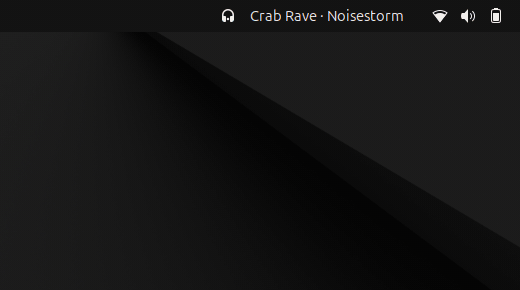


</div>

---

## Install

Open a terminal and run:

```bash
curl -fsSL https://raw.githubusercontent.com/NGdev2/earful/main/install.sh | sh
```

Then restart your computer. From then on Earful starts by itself (switch it off any time in the Extensions app).

It needs GNOME 46 or newer and no sudo: everything goes into your home folder. You can [read the script](install.sh) first.

### Browser tabs as separate players (optional)

Without this, Earful shows your browser as one player. With it, **every tab that plays gets its own row**. Add the free *Earful Bridge* add-on to your browser; Earful sets up everything else by itself.

- **Chrome, Brave, Edge, Vivaldi, Opera:** [add Earful Bridge from the Chrome Web Store](https://chromewebstore.google.com/detail/hlomkcgmmialafamfkkpiamgefhlidll).
- **Firefox:** [add Earful Bridge from Firefox Add-ons](https://addons.mozilla.org/firefox/addon/earful-bridge/).

Firefox from Snap asks once whether it may start Earful: choose *Allow*. Browsers installed as Flatpak, and Chromium from Snap, can't use the add-on yet.

<details>
<summary><b>Install from source</b> (for developers; not needed if you ran the command above)</summary>
<br>

```bash
git clone https://github.com/NGdev2/earful.git
cd earful
make install
```

`make install` does exactly what the command above does, from your checkout.
</details>

To remove Earful: `curl -fsSL https://raw.githubusercontent.com/NGdev2/earful/main/install.sh | sh -s -- --uninstall`

## Why Earful?

**"Who sings this?"** When the track changes, a small popup fades in with the cover, title and artist, then quietly fades out. Several changes at once stack neatly. Point at it to pause or skip, or close it with ✕.

**One click, every player.** All your players in one list, each with its own play / pause / next. Click a track to jump straight to its app.

**Every browser tab is its own player.** Three YouTube tabs, three rows. Click one and Earful switches to that exact tab (Chrome, Brave, Edge and other Chromium browsers, Firefox).

<p align="center">
  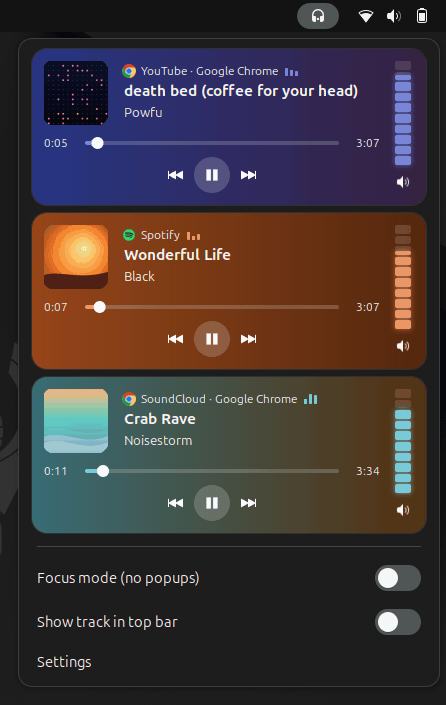
</p>

**Where you are in the song.** The time and a bar on every player: drag it to jump. Live streams show no bar, and when a site ignores the jump (a YouTube ad), the bar waits instead of flickering.

**A mini mixer.** A volume on every player and every tab, plus (optional) apps that only make sound, like games and calls. Put it beside the cover or on the right, as LED steps, a knob, a pill or a line. Or scroll on the cover and watch it fill like a glass of water.

<p align="center">
  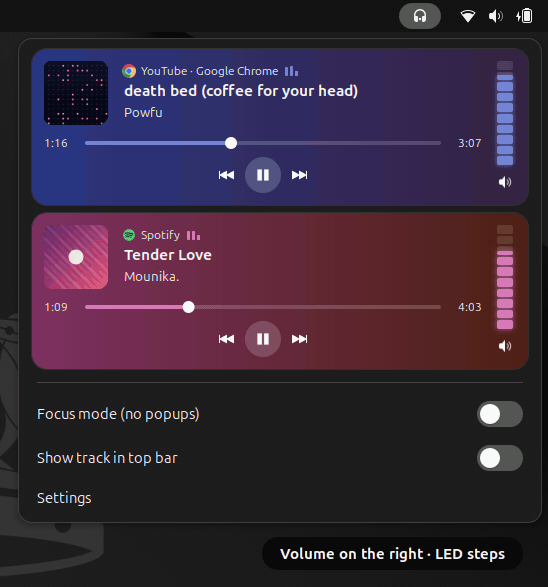
  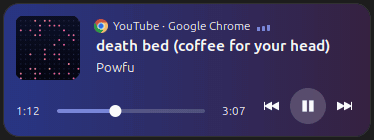
</p>

**Copy a title in one click.** Click a title or artist to copy it, to look it up later. Long titles slide so you can read them to the end.

**Your look.** A spinning vinyl, a cassette, a retro hi-fi equalizer, a sound wave or a note riding the road, in the colors of each album cover (or of the app, when there is no cover) or one you pick. The art fades as you turn a player down. Or keep it calm: a gradient, dark glass, or your system theme.

<p align="center">
  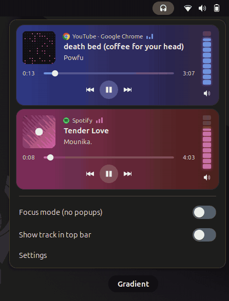
</p>

**Popups your way.** Six styles: controls on hover, classic, a Next button with a timer line, a mini pill, an island that grows when you point at it, and a big cover. *Show example* in Settings tries them right away.

<p align="center">
  
</p>

**Your rules.** Pause other players when one starts (with exceptions), and send media keys to the last active or a pinned player.

**Focus mode.** Deep in code? One shortcut (<kbd>Super</kbd> + <kbd>Shift</kbd> + <kbd>M</kbd>) silences every popup. No popups over fullscreen games or while Do Not Disturb is on.

**You decide.** Cards, list or compact menu; popup position, duration, how many at once, and which players are allowed to show them. Settings come in three pages: Menu, Popups and Behaviour.

**[See every look →](docs/looks.md)**

<details>
<summary>More screenshots</summary>
<br>
<p align="center">
  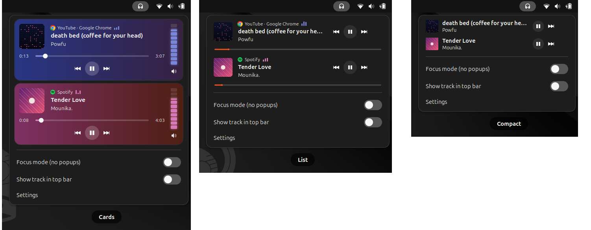
</p>
<p align="center">
  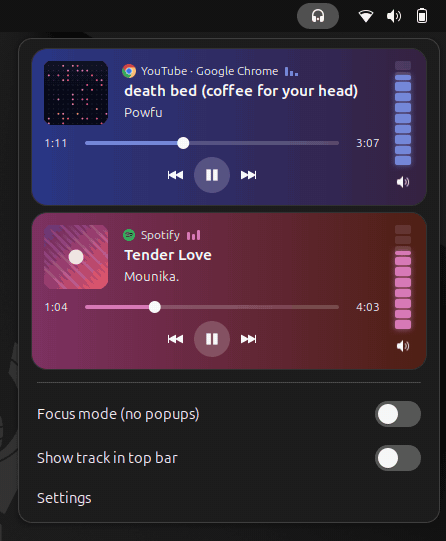
</p>
<p align="center">
  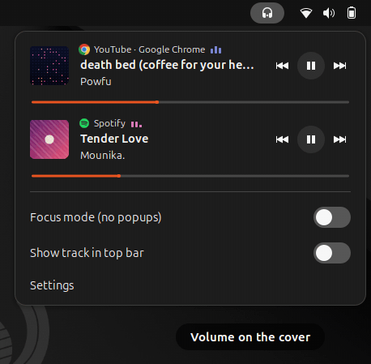
  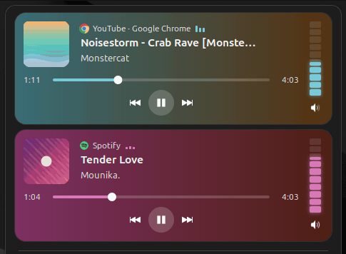
</p>
<p align="center">
  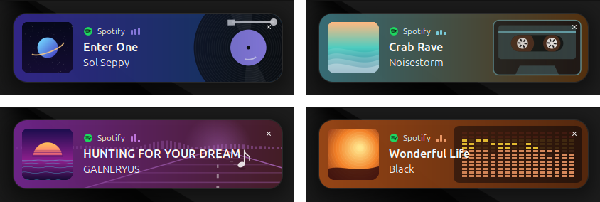
</p>
<p align="center">
  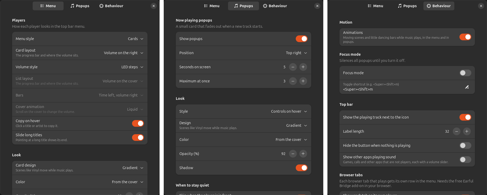
</p>
</details>

## Coming next

- One-click install from extensions.gnome.org (GNOME's official extension website): in review
- Popups anywhere: drag a popup to any spot on the screen ([#5](https://github.com/NGdev2/earful/issues/5))

More ideas, nothing promised: [docs/ideas.md](docs/ideas.md).

## How it works

Linux media players announce what they play through [MPRIS](https://specifications.freedesktop.org/mpris-spec/latest/), a shared standard. Earful listens to it, so Spotify, VLC, Rhythmbox, browsers and more show up by themselves. For mpv, install the `mpv-mpris` plugin (`sudo apt install mpv-mpris`); without it, mpv still shows under *Other audio* with the file it plays.

Browsers announce only one player for all their tabs. The Earful Bridge add-on reports each playing tab to a small helper program that comes with Earful, and the helper announces every tab as its own player. Details: [browser-extension](browser-extension/README.md) · [the helper](docs/bridge.md).

No tracking, nothing sent anywhere: the only network traffic is loading cover art from the address a player provides. See [PRIVACY.md](PRIVACY.md).

## Contributing

Ideas, bugs and pull requests are welcome: open an [issue](https://github.com/NGdev2/earful/issues).

- Try it without real music: `gjs -m tools/fake-player.js MyPlayer 5`
- `make test` runs Earful in an invisible, isolated GNOME Shell; `make test-gnome-versions` does it for GNOME 47–51 in containers
- `make bridge-test`, `make bridge-test-browser` and `make bridge-test-firefox` check the browser tabs; `make test-install` checks the installer; `make lint` the code
- `make demo` records the pictures above the same way, with fake players and drawn covers (`tools/record-demo.sh docs/media looks` makes the stills of [every look](docs/looks.md))

## License

[GPL-3.0](LICENSE)
