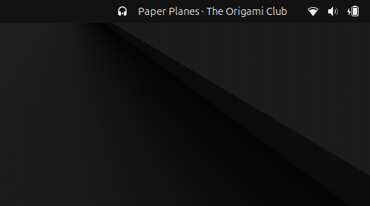
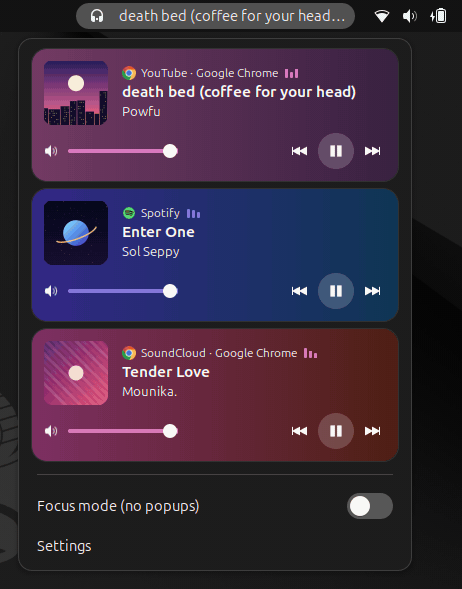
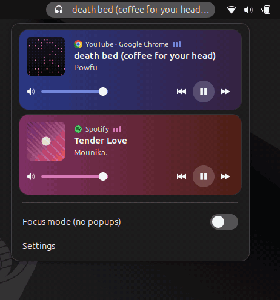
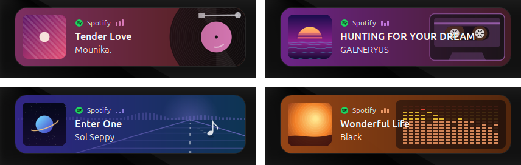
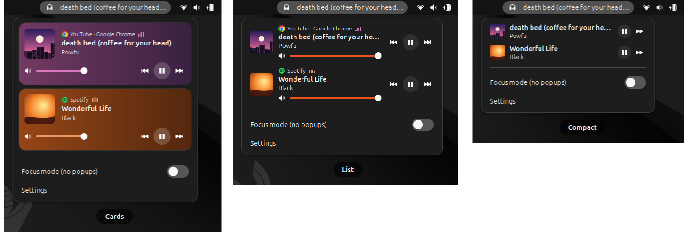
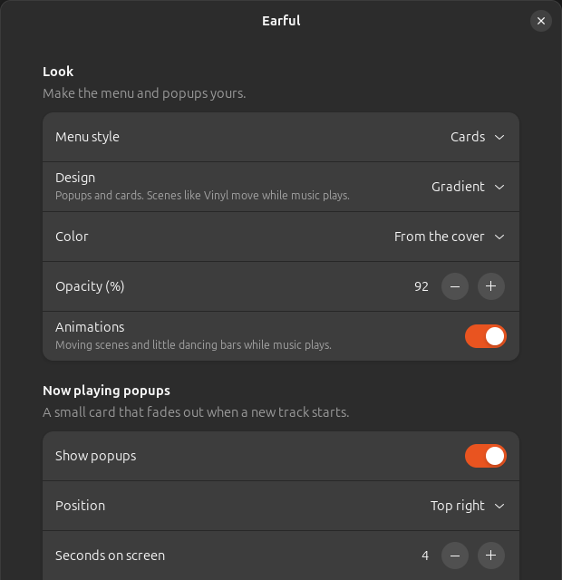

<div align="center">

# 🎧 Earful

**Every player, one click away.**

See and control everything that plays on your Linux desktop — Spotify, YouTube tabs, Twitch, podcasts —
from one button in the top bar. Catch the song name in a gentle popup, then get back to work.




</div>

---

## Why Earful?

🎵 **"Who sings this?"** — when the track changes, a small card fades in with the cover, title and artist, then quietly fades out. Several changes at once stack neatly and slide into place.

🧭 **One click, every player** — all your players in one list, each with its own play / pause / next. Click a track to jump straight to its app.

🗂️ **Every browser tab is its own player** — three YouTube tabs, three rows. Click one and Earful switches to that exact tab (Chromium, Chrome, Brave, Edge).

🔊 **A mini mixer** — a volume slider on every player and every tab, plus (optional) apps that only make sound, like games and calls.

<p align="center">
  
</p>

🎨 **Your look** — a spinning vinyl, a cassette, a retro hi-fi equalizer, a sound wave or a note riding the road, in the colors of each album cover or one you pick. Or keep it calm: a gradient, dark glass, or your system theme.

<p align="center">
  
</p>
<p align="center">
  
</p>

⏯️ **Your rules** — pause other players when one starts (with exceptions), and send media keys to the last active or a pinned player.

🤫 **Focus mode** — deep in code? One shortcut (<kbd>Super</kbd> + <kbd>Shift</kbd> + <kbd>M</kbd>) silences every popup. No popups over fullscreen games or while Do Not Disturb is on.

🎚️ **You decide** — cards, list or compact menu; popup position, duration, how many at once, and which players are allowed to show them.

<details>
<summary>More screenshots</summary>
<br>
<p align="center">
  
</p>
<p align="center">
  
</p>
</details>

## Coming next

- 🦊 **Firefox** support for the per-tab bridge
- 🙈 **Ignore list** for autoplay noise
- 📦 One-click install from extensions.gnome.org and the Chrome Web Store

## Install

> Earful is in early preview. A one-click install from extensions.gnome.org is on the way.

```bash
git clone https://github.com/NGdev2/earful.git
cd earful
make install
```

Then log out and back in (on X11 you can press <kbd>Alt</kbd> + <kbd>F2</kbd>, type `r`, Enter) and run:

```bash
gnome-extensions enable earful@NGdev2.github.io
```

**Per-tab browser players** (optional):

1. `make bridge-install`
2. Open `chrome://extensions`, turn on *Developer mode*, click *Load unpacked* and pick the `chromium-extension` folder.
3. Reload tabs that were already playing.

Details: [chromium-extension](chromium-extension/README.md) · [native-host](native-host/README.md)

## How it works

Earful listens to [MPRIS](https://specifications.freedesktop.org/mpris-spec/latest/), the standard way Linux media players share what they play. Anything that supports it — Spotify, browsers, VLC, Rhythmbox, Firefox, Chromium and more — shows up automatically. For mpv, install the `mpv-mpris` plugin (`sudo apt install mpv-mpris`); without it, mpv still shows under *Other audio* with the file it plays. Earful sends nothing anywhere and has no tracking; the only network traffic is loading cover art from the URL a player provides.

## Contributing

Ideas, bugs and pull requests are welcome — open an [issue](https://github.com/NGdev2/earful/issues).
Test without real music using the fake player: `gjs -m tools/fake-player.js MyPlayer 5`.
`make test` runs Earful in an invisible, isolated GNOME Shell; `make lint` and `make bridge-test` check the rest.
`make demo` records the pictures above the same way, with fake players and drawn covers.

## License

[GPL-3.0](LICENSE)
