# Every look

What Earful can look like, from the real app. Everything here is in Settings (click the Earful button, then *Settings*); the first of each kind is the default. The pictures are made with `tools/record-demo.sh docs/media looks`.

## Card layouts

Settings → Menu → *Card layout*. Where the volume sits, and the progress bar.

<table>
<tr><td align="center">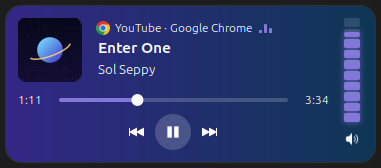 Volume on the right</td><td align="center">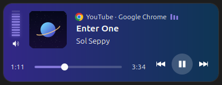 Volume beside the cover</td></tr>
<tr><td align="center">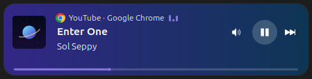 Slim: the volume slides out, the progress runs along the edge</td><td align="center">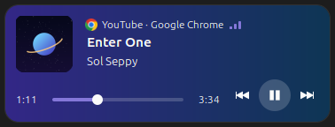 Volume on the cover: scroll on it</td></tr>
</table>

## Volume styles

Settings → Menu → *Volume style*, for the layouts with a standing volume.

<table>
<tr><td align="center">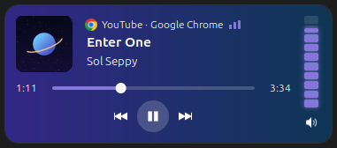 LED steps</td><td align="center">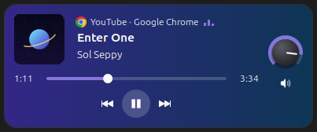 Knob</td></tr>
<tr><td align="center">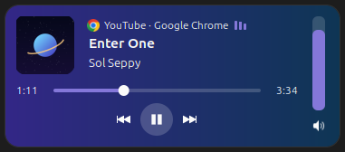 Pill</td><td align="center">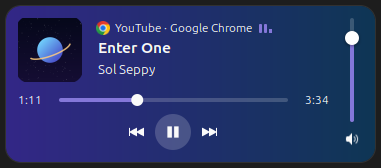 Line</td></tr>
</table>

## Volume on the cover

Settings → Menu → *Cover animation*. Scroll on the cover to change the volume; it shows like this for a moment.

<table>
<tr><td align="center">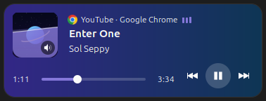 Liquid</td><td align="center">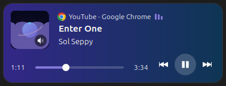 Cloud</td></tr>
<tr><td align="center">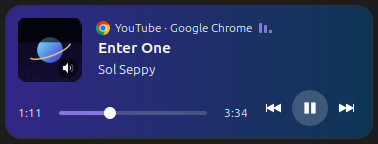 Dim above</td><td align="center">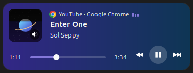 Gray above</td></tr>
<tr><td align="center">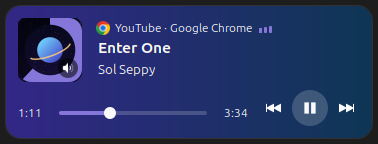 Ring</td><td align="center">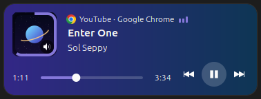 Frame</td></tr>
<tr><td align="center">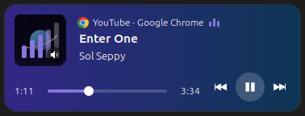 Bars</td><td align="center"> Percent</td></tr>
<tr><td align="center">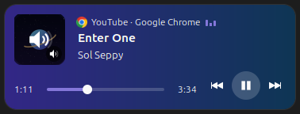 Speaker waves</td><td align="center">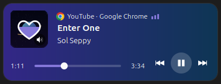 Heart</td></tr>
</table>

## List layouts

Settings → Menu → *Menu style: List*, then *List layout*. Smaller rows.

<table>
<tr><td align="center">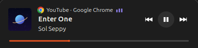 Volume on the cover, progress along the edge</td></tr>
<tr><td align="center">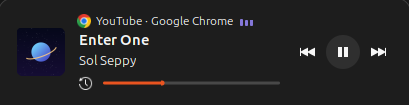 One line, two jobs: progress, or the volume after a click on the speaker</td></tr>
<tr><td align="center">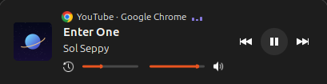 Two bars: time and volume side by side</td></tr>
</table>

## Designs

Settings → Menu → *Card design*. The scenes (vinyl to cassette) move while music plays and fade as you turn a player down.

<table>
<tr><td align="center"> Gradient</td><td align="center">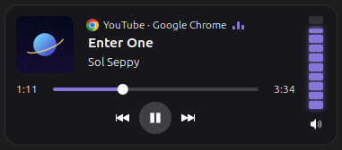 Dark glass</td></tr>
<tr><td align="center">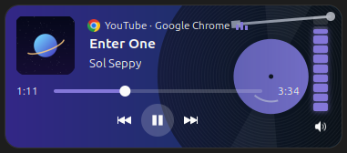 Vinyl</td><td align="center">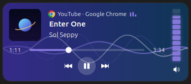 Sound wave</td></tr>
<tr><td align="center">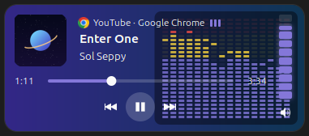 Retro equalizer</td><td align="center">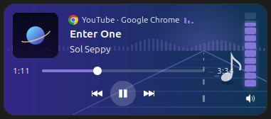 Note road</td></tr>
<tr><td align="center">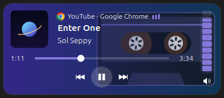 Cassette</td><td align="center">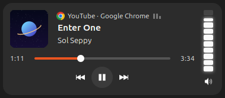 System theme</td></tr>
</table>

## Colors

Settings → Menu → *Color*. By default the colors come from the cover (or from the app's icon when there is no cover). Or pick one:

<table>
<tr><td align="center">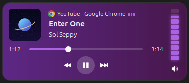 Purple</td><td align="center">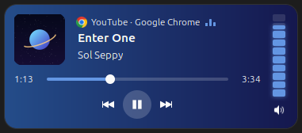 Blue</td><td align="center">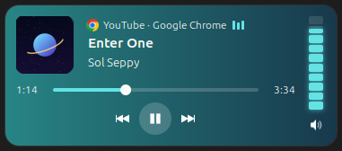 Teal</td><td align="center">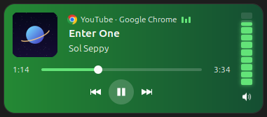 Green</td></tr>
<tr><td align="center">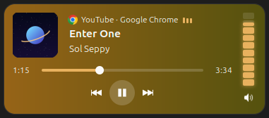 Amber</td><td align="center">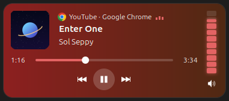 Red</td><td align="center">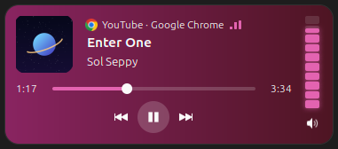 Pink</td><td align="center">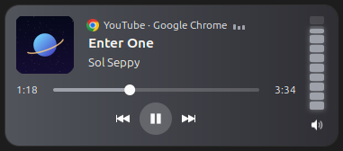 Graphite</td></tr>
</table>

## Popup styles

Settings → Popups → *Style*. *Show example* at the top of that page shows one right away. Popups have their own design and color too.

<table>
<tr><td align="center">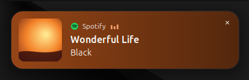 Controls on hover</td><td align="center">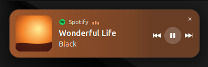 … pointed at</td></tr>
<tr><td align="center">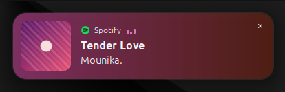 Classic, no controls</td><td align="center">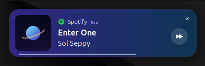 Next button and timer line</td></tr>
<tr><td align="center">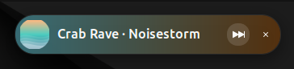 Mini pill</td><td align="center">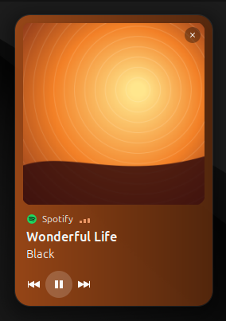 Big cover</td></tr>
<tr><td align="center">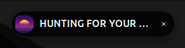 Island</td><td align="center">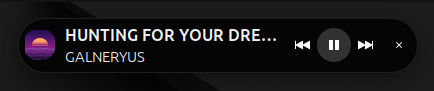 … pointed at: it grows</td></tr>
</table>

Menu styles, designs on popups and the settings pages are in the [README](../README.md#why-earful).
